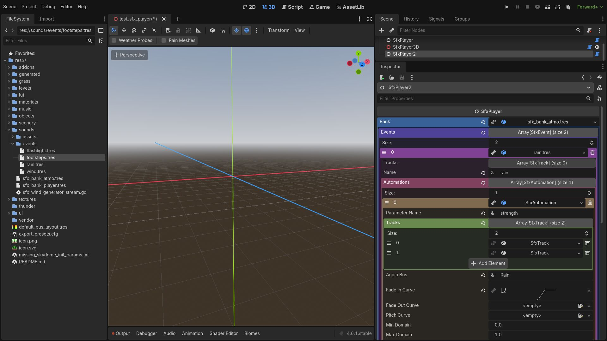

# Godot SFX

Simple Sound Effects System for Godot inspired by FMOD



## Features

* Sound effect banks for organization and reuse
* Sound events with multiple tracks and automation for sample blending
* Time based and parameter based playback
* Fade-in and fade-out curves
* Routing tracks to audio buses
* Uses built-in AudioStreams
* Player parameters read by every event, derived parameters (expressions, smoothing, rate of change)
  and triggers that start and stop events from them
* Native (C++ GDExtension) playback, ticked on worker threads; a sound at rest costs nothing per frame
* Single and double precision builds, Linux (glibc 2.34), Windows and Android (arm64)
* Open source

## API and building

See [docs/API.md](docs/API.md); the class reference is in the editor (F1). In short:

```sh
git submodule update --init --recursive
make compile-debug          # PRECISION=double for a double precision Godot
make import test
```

## Hints

* Use `AudioStreamRandomizer` for sequential, shuffle or random playback of multisamples
* Use `AudioStreamPlaylist` to play multisample automatically ina a sequence

## TODO

* Custom loops for samples (independent from import time)
* Multiple samples per track
* Automation of Audio Bus and it's effects
* Standalone Sound Effect Maker (similar to Material Maker, inspired by FMOD)

## Credits

The demo project's sound effects are sourced from [Freesound.org](https://freesound.org) under various Creative Commons licenses - see [demo/sounds/assets/CREDITS.md](demo/sounds/assets/CREDITS.md) for per-file attribution.
